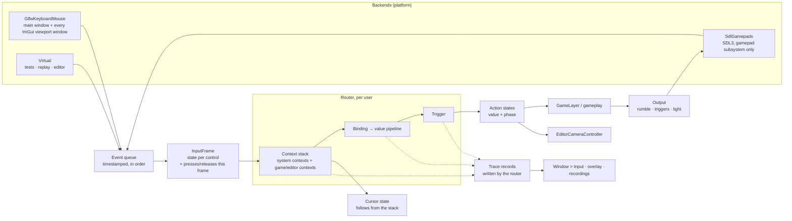

# Input system

Proposal written 2026-10-13, reworked the same day. Nothing of this exists yet.

Keyboard, mouse and gamepads (Xbox, DualShock 4, DualSense) go through one system. The game reads *actions* such as Move, Look and Jump, never keys or buttons. The system has to answer two questions without a debugger:

- **"Why did / didn't this happen?"** Who got a button, what each step made of a stick's value, why an action fired or didn't.
- **"How do I set this up for what I want?"** Which binding, trigger and numbers give a charged jump, a precise aim, a sprint that holds or toggles, and whether the setup has mistakes before anyone plays it.

## Today

- **Editor fly camera:** `VulkanRenderer` polls GLFW itself (`glfwGetKey`, `glfwGetMouseButton`, `glfwGetCursorPos` on the main window), in two near-copies: `TickActiveEditorSceneViewFromInput` and `TickEditorCameraFromInput`. Camera speed and sensitivity live in the renderer. The mouse wheel goes `WindowsWindow::GLFW_ScrollCallback` → `IRenderer::OnMouseWheelScrolled`.
- **Editor shortcuts:** ImGui (`IsKeyChordPressed` in `SceneEditor`, `IsKeyPressed` W/E/R in `TransformGizmo`).
- **Game:** no input, apart from Ctrl+Alt+Shift+C through ImGui.
- **Gamepads:** none. The GLFW fork (3.5) could read them, ImGui's GLFW backend doesn't use them (no `NavEnableGamepad`).

What follows from that:

- Input code sits in the renderer and can't be tested without a window.
- Polling once per frame loses a press and release that both happen between two frames. At 30 fps, a tap shorter than 33 ms never happened. Harmless for flying; not for Jump.
- `glfwGetKey` reads the *main* window. A scene view dragged out of the editor lives in an OS window of its own, which ImGui's backend gives its own callbacks, and GLFW releases the main window's keys when it loses focus. By reading the code, WASD and right-mouse look don't work in a floating scene view. (Not tried.)
- Keys, speeds and sensitivity are hard-coded.

## What not to copy from Unreal

Unreal's input is hard to follow because several systems each decide a part of who gets input, and much of it is state that someone set somewhere else:

- Slate sees input first;
- `SetInputMode` (GameOnly, UIOnly, GameAndUI) is a flag anyone can set at any time, and the last caller wins;
- the PlayerController's stack of InputComponents;
- Enhanced Input's mapping contexts on top of that;
- CommonUI's action router and its stack of activatable widgets, which override the input mode again;
- CommonInput, which keeps the current input type for glyphs on its own;
- and a "consume" rule in several of these.

When a button does nothing, the answer is in any of them, and none can say which.

So Nyx has these rules:

1. **One router.** Each user's context stack is the only thing that decides who gets a control. Window focus, ImGui wanting the keyboard, an open menu, the debug overlay: each is a context on that stack, with a priority, not a separate mechanism.
2. **No modes that are set.** There is no input mode and no `SetCursorCaptured`. Whether the cursor is free, hidden or captured follows from the stack: the topmost context that says something about the cursor decides.
3. **The trace is the truth.** The router writes down every decision as it makes it (what a binding got, what each step made of it, where it stopped and why). The debug window only reads these records; it doesn't work anything out again, so it can't disagree with what happened.
4. **Presets write plain data.** Recipes and calibration fill in ordinary bindings and numbers you can see and change. There is no hidden behaviour behind a preset's name.
5. **One boundary, said out loud.** The editor's shortcuts and its UI navigation are ImGui's, not the input system's (see *ImGui*). The game asks the input system only, never ImGui, about keys.

## Done when

- The game reads actions. The same action works from keyboard and mouse, an Xbox pad, a DualShock 4 and a DualSense, and the player can switch between them at any time; prompts show the glyphs of the device used last.
- Pads can be plugged in and out while playing. A pad that comes back is the same player's pad again.
- Rumble works on all three pads. The DualSense's adaptive triggers and lightbar, and the gyro and touchpad of DualShock 4 and DualSense, can be used.
- Dead zones, curves, sensitivity, hold and tap times are data. The details panel edits them with undo, and a running game (each game of Play All) takes the change in the next frame, like live edits.
- *Window > Input* answers "why did / didn't this happen?" through one kind of answer, "taken by *context* at priority *n*", or the step that stopped a value. It shows the editor's own input or that of any running game; a game on its own shows the same as an overlay.
- New actions start from recipes named by intent; the checks find conflicts, gaps and the usual mistakes; calibration measures a pad and suggests dead zones; settings can be compared A against B, live and on a replayed recording.
- Input can be recorded and replayed. `NyxDump` prints recordings; tests replay them.
- `NyxInputTests` run without a window and without devices.
- The renderer contains no input code. The editor's fly camera goes through the input system and works in floating scene views.

## The shape of it



Where it lives: `Engine/Source/Runtime/Input`, in `NyxEngine`, namespace `Nyx::Input`. `Application` owns the `InputSystem`, made right after the window, and the frame loop becomes:

```
Window->PollEvents();          // backends push events into the queue
Input->BeginFrame(now);        // drain the queue into the InputFrame, route, evaluate actions
layers OnUpdate(deltaTime);    // read actions
Window->DrawFrame(...);        // layers OnUI(); the Input window draws here
Input->EndFrame();             // send rumble/light changes, apply the cursor state, publish diagnostics
```

Everything runs on the main thread. Input is sampled right before `OnUpdate`, so it's as fresh as it can be without a second thread.

## 1. Backends

```cpp
class IInputBackend
{
public:
    virtual ~IInputBackend() = default;
    virtual void Poll(InputEventSink& sink) = 0;                      // devices added/removed, control changes
    virtual void ApplyOutput(InputDeviceId, const DeviceOutput&) {}   // rumble, triggers, light
};
```

### Keyboard and mouse: GLFW

- Callbacks (key, mouse button, cursor, scroll, focus) on the main window, installed **before** `ImGui_ImplGlfw_InitForVulkan`, which then chains to them, as it already does for the scroll callback.
- ImGui gives the OS windows it makes for floating windows its own callbacks, without chaining. The backend wraps `ImGuiPlatformIO::Platform_CreateWindow`: it calls ImGui's function, then installs its callbacks on the new window, which call ImGui's. This fixes the floating scene view.
- Keys are stored by *position* (GLFW's key codes are named after the US layout but mean the physical key), so WASD sits under the left hand on QWERTZ and AZERTY too. For display, the backend asks `glfwGetKeyName`, so a German keyboard shows *Z* for the key a US one calls Y.
- Mouse look uses raw motion (`GLFW_RAW_MOUSE_MOTION`) while the cursor is captured, never `glfwGetCursorPos` differences.
- Text input stays ImGui's.

### Gamepads: SDL3, gamepad subsystem only

SDL3 as a git submodule like the others, built static with only joystick, gamepad, haptic, sensor and HIDAPI (video, audio, render and GPU off). `SDL_Init(SDL_INIT_GAMEPAD)` without SDL windows; GLFW keeps the window.

Why not GLFW's gamepads: no rumble, no sensors, no touchpad, no lightbar, no trigger effects, no battery or connection type, and DualShock/DualSense only through DirectInput mappings.

Why not XInput + raw HID by hand: XInput covers Xbox only; the DualSense's output reports differ between USB and Bluetooth, the Bluetooth ones need a CRC, and adaptive triggers are bytes in those reports. SDL's HIDAPI drivers already do all of that, are maintained, and are what Steam relies on. The cost is one more dependency and its build time.

What Nyx uses from SDL: `SDL_EVENT_GAMEPAD_ADDED/REMOVED` and button events (so short taps aren't lost), `SDL_GetGamepadAxis` each frame for sticks and triggers, `SDL_GetGamepadType` for the model, `SDL_RumbleGamepad`, `SDL_RumbleGamepadTriggers`, `SDL_SetGamepadLED`, `SDL_SetGamepadPlayerIndex`, `SDL_SendGamepadEffect` for the DualSense's trigger effects, `SDL_SetGamepadSensorEnabled` for the gyro and accelerometer, `SDL_GetGamepadTouchpadFinger`, `SDL_GetGamepadPowerInfo` and `SDL_GetGamepadConnectionState`.

**To check first** (a short spike before change 3): that SDL without its video subsystem delivers pad input on Windows while an OS window it doesn't know has focus. Its "background events" rule should only apply when SDL has windows of its own; Nyx decides about focus itself anyway, through the *Unfocused* context.

### Virtual

Devices made by code: tests, replay, later on-screen or editor-driven pads. It's the same `InputEvent` path, so nothing downstream can tell the difference.

## 2. Devices and controls

```cpp
enum class EDeviceKind : uint8_t { Keyboard, Mouse, Gamepad };
enum class EGamepadModel : uint8_t { Unknown, Xbox360, XboxOne, DualShock4, DualSense, DualSenseEdge, Generic };
enum class EDeviceCapability : uint32_t
{
    Rumble = 1 << 0, TriggerRumble = 1 << 1, AdaptiveTriggers = 1 << 2, Gyro = 1 << 3,
    Accelerometer = 1 << 4, Touchpad = 1 << 5, Lightbar = 1 << 6, PlayerLeds = 1 << 7,
};

struct InputDeviceInfo
{
    InputDeviceId Id;          // new for every connection
    std::string Name;          // "DualSense Wireless Controller"
    std::string StableKey;     // serial / path: a pad that comes back gets its player back
    EDeviceKind Kind;
    EGamepadModel Model;
    EConnection Connection;    // Usb, Bluetooth, Wireless adapter
    const char* Backend;       // "GLFW", "SDL HIDAPI", "SDL XInput", "Virtual"
    uint32_t Capabilities;
    std::optional<int> BatteryPercent;
};
```

Controls have an enum for code and a **path** for data, logs and the debug window:

```
Keyboard/W   Keyboard/Space   Mouse/Delta   Mouse/Wheel   Mouse/Right
Gamepad/LeftStick   Gamepad/RightTrigger   Gamepad/FaceSouth   Gamepad/DpadUp
Gamepad/Gyro   Gamepad/Accel   Gamepad/Touchpad/0   DualSense/Mute
```

Face buttons are named by position (South/East/West/North, like SDL): *Cross* on a DualSense and *A* on an Xbox pad are both `Gamepad/FaceSouth`. What's printed on the button only matters for glyphs. A binding to `Gamepad/...` matches every pad; `DualSense/...` only those that have the control.

Values are one of `bool`, `float`, `vec2`, `vec3`.

## 3. Events and the input frame

- Backends push `InputEvent{ timestampUs, device, control, value }` during `PollEvents`.
- `BeginFrame` applies them in order to the `InputFrame`: per control, its value now and at the end of the previous frame, and for buttons how often it went down and up this frame. A tap within one frame counts as pressed *and* released; `WasPressed` is true for that frame even though `IsDown` is false.
- The time of the last press is kept from the event, not the frame, so a 500 ms hold is 500 ms of real time at any frame rate.
- Ready for a fixed-step simulation later: an action that triggered stays "unconsumed" until the code reading it calls `Consume`, so a press that lands in a frame that runs zero simulation ticks isn't lost, and one that lands in a frame with two ticks doesn't jump twice.

## 4. The router: one stack per user

A **context** is a named set of bindings that is on or off as a whole, with a priority. Each user has a stack of them. Each frame, for every control that changed or is held, the router goes down the stack from the highest priority; the first context with a binding for that control gets it and, by default, **takes** it, so lower contexts don't see it. A binding can be marked to let the control through.

With `Menu` above `OnFoot`, FaceSouth confirms in the menu and doesn't also jump; Look still works, because `Menu` doesn't bind the right stick.

### System contexts

What other engines handle in separate mechanisms are contexts here, pushed and popped by the engine, on every user's stack:

| Priority | Context | On while | Takes |
|---|---|---|---|
| 1000 | `Unfocused` | the program's window doesn't have focus | everything; pads too, unless `--input-background` |
| 900 | `ImGui` | ImGui has a text field active, or the mouse is over ImGui UI that isn't a view (below) | the keyboard while typing; the mouse over that UI |
| 800 | `DebugOverlay` | the overlay is open and being clicked | the mouse |
| 0–799 | game or editor contexts | pushed by their code | what they bind |

"A view" is an ImGui window that shows a scene: the editor's scene views and the game's own window, which today is an ImGui window covering everything. Those mark themselves (`Nyx::Input::MarkAsView()`), so ImGui hovering them doesn't take the mouse away from the game or the fly camera. Everything else ImGui draws takes the mouse while hovered.

Because these are entries on the stack, "nothing happens while I type in the outliner" and "the pad does nothing in the second Play All window" have the same kind of answer as "Jump is taken by the menu": a context, its priority, the control it took.

### The cursor follows from the stack

A context can say `Cursor: Free | Hidden | Captured`. The topmost context that says anything decides; nothing sets the cursor from code. `EditorFlyCamera` says *Captured* while mouse look is held; `Unfocused` says *Free*. `EndFrame` applies the result through GLFW (`GLFW_CURSOR_DISABLED` plus raw motion for *Captured*). The Contexts tab shows which context decided.

### ImGui

ImGui reads GLFW's events through its own callbacks, as now. The input system doesn't feed ImGui and ImGui doesn't feed the input system; they touch in one place, the `ImGui` system context, built from ImGui's state of the previous frame (`WantTextInput`, the hovered window).

- **Editor shortcuts and UI navigation stay with ImGui.** They're commands bound to characters (Ctrl+Z is the key that *says* Z), scoped to whichever panel has focus, which is what ImGui's key routing does well. What they need is a table of their own (name, chord, handler) so menus can show them and they can be changed; that's an editor change, separate from this.
- **The game never asks ImGui about keys.** Ctrl+Alt+Shift+C (crash on purpose) and Ctrl+Alt+Shift+I (overlay) become bindings in a `Debug` context, Debug builds only.
- In-game UI later doesn't get a router of its own: a menu is a context, with its priority and its bindings.

## 5. Actions, bindings, triggers

### Actions

```cpp
struct InputActionDef
{
    std::string Name;          // "Move"
    EActionValue ValueType;    // Button, Axis1D, Axis2D, Axis3D
};
```

Code holds a handle (via `TypedHandle.h`), resolved once when the actions are loaded. An action name that doesn't exist is an error at load, which names the closest ones that do.

```cpp
const Input::ActionState& move = Player.Get(Actions.Move);
Velocity = move.Vec2() * WalkSpeed;

if (Player.ConsumeTriggered(Actions.Jump))
{
    Jump();
}
```

Only polling, no callbacks: what runs when is visible in the calling code and in a debugger's call stack.

Phases: `Idle → Started → Ongoing → Triggered → Completed` or `Canceled`. A Hold of 0.5 s is *Started* at the press, *Ongoing* while held, *Triggered* at 0.5 s, *Canceled* if let go before. `ActionState` also has `HeldFor()`, for charging.

### Bindings and the value pipeline

A binding is: action + control path (or a composite, e.g. *2D from four keys: W, S, A, D*) + a value pipeline + a trigger.

The pipeline has a **fixed order**. Each step can be switched off, but not moved:

| # | Step | Settings |
|---|------|----------|
| 1 | Dead zone | shape: Axial, Radial, Scaled radial (default), Hybrid; inner, outer |
| 2 | Response curve | Linear, Power (exponent), Custom (points) |
| 3 | Sensitivity | per axis; Invert X / Y |
| 4 | Look acceleration | for sticks: after *x* ms past 0.9, ramp up to *y* times over *z* ms |
| 5 | Smoothing | time constant in ms; off by default |
| 6 | Delta time | multiply by the frame time, for rates |

A composite of keys has *Normalize* on by default, so W+D isn't 1.41 times as fast as W.

Why fixed instead of a free list of modifiers like Enhanced Input: the trace always has the same columns, the details panel shows one struct instead of a list of polymorphic objects, and the order "dead zone before curve before sensitivity" is the one that's right nearly always. A step that really needs another place can become a new fixed step.

Triggers: `Down` (default), `Pressed`, `Released`, `Toggle`, `Hold(time, once | repeat)`, `Tap(maxTime)`, `DoubleTap(maxGap)`, `Chord(other action)`, `Repeat(delay, rate)`, plus `Buffer(ms)` on any of them, e.g. a Jump pressed 100 ms before landing still jumps.

The analog-to-button threshold (a trigger pulled far enough counts as pressed) is a setting of the binding with hysteresis (press at 0.5, release at 0.4), so a trigger resting near the threshold doesn't flicker.

### Users

An `InputUser` is a player: their devices, their context stack, their action states, the device they used last. There is one from the start, which owns every device ("any device"), so single-player code never mentions devices. Local multiplayer later assigns pads to users by a button press; the shape doesn't change.

### Which device was used last

For glyphs. A stick only counts once it leaves its dead zone and the mouse only after a few pixels, so a drifting stick or a nudged mouse doesn't flip the prompts back and forth. This is part of the user, not a subsystem of its own.

## 6. Output: rumble, triggers, light

```cpp
Player.Rumble({ .Low = 0.6f, .High = 0.2f, .DurationMs = 120 });
Player.TriggerRumble(ETrigger::Right, 0.4f, 80);              // Xbox impulse triggers, DualSense
Player.SetTriggerEffect(ETrigger::Right, TriggerEffect::Weapon{ .Start = 0.3f, .End = 0.6f, .Strength = 0.8f });
Player.SetLightColor({ 1.0f, 0.2f, 0.1f });
```

- Sent once per frame in `EndFrame`, merged: two rumbles in one frame make one, with the stronger of each motor.
- A pad without the capability ignores the call. The trace records it anyway, crossed out: "SetTriggerEffect: Xbox One has no adaptive triggers".
- The DualSense's trigger effects (Off, Resistance, Section, Weapon, Vibration) are bytes in its output report; Nyx encodes them and passes them through `SDL_SendGamepadEffect`. This is the one part SDL doesn't do for us.
- A global haptics strength (tuning) and a player setting (accessibility) scale everything; 0 turns it off.

## 7. Tuning: data, in layers

Actions, contexts, bindings and tuning live in an input asset, `Assets/Input/Default.nyxinput`, written by the reflection system like scenes are. That gives the details panel, undo and saving without new code.

**Reflection needs two new property kinds first:** `Enum` (dead-zone shape, trigger type, …) and `Array` (a context's bindings). `ReflectionTypes.h` lists everything a new kind touches. Both are worth having outside of input too.

Values come in layers; the later wins:

1. the asset (the designer's defaults);
2. a profile per pad model, e.g. a larger inner dead zone for a model whose sticks drift more;
3. the player's settings (sensitivity, invert Y, hold or toggle, haptics strength, rebinding), in a file of their own, never in the asset.

Every value shown anywhere says which layer it came from.

**Live tuning:** a new editor link message `SetInputAsset` carries the changed asset, written by the reflection serializer like `SetProperties` carries components. Every running game, all of Play All included, swaps it in at the start of its next frame, keeping action phases and held buttons. Dragging a dead-zone slider in the editor changes how the game feels while holding the stick.

## 8. Finding the right setup

The system is tested against intents, not only against bugs. For each intent: how does someone get from "I want …" to the right bindings and numbers?

### Recipes

*Add Action* asks what the action is for, not which trigger it needs. Each recipe writes plain bindings into the asset, for keyboard and mouse and for pads, which are edited like any others afterwards:

| Intent | What the recipe writes |
|---|---|
| Do it once per press (jump, interact) | Button, `Pressed`, `Buffer(100 ms)` |
| Do it while held (sprint, block) | Button, `Down`; *Hold or toggle* as a player setting (`Toggle`) |
| Charge, release to do it (charged shot) | Button, `Released`; the code reads `HeldFor()`; a maximum charge time in tuning |
| Tap for one thing, hold for another (tap: interact, hold: reload) | two actions on one button: `Tap(0.2 s)` and `Hold(0.3 s)`; the hold time is kept above the tap time |
| Move | 2D: left stick, scaled radial dead zone; WASD composite, normalized |
| Look / aim | right stick: power curve 2, look acceleration, *Delta time*; mouse delta: sensitivity only, no *Delta time*, no smoothing; gyro optional |
| Analog amount (throttle, brake) | 1D: trigger, small dead zone, no threshold |
| Step through a menu | stick and D-pad to discrete steps with `Repeat(0.4 s, 0.1 s)` and threshold hysteresis |

The Look recipe exists mostly because of one common mistake: mouse delta is already a distance travelled this frame, and multiplying it by the frame time makes aiming depend on the frame rate. A stick is a speed and needs it.

### Checks

Run when the asset is loaded or saved and while editing it, shown beside the field they're about, in the Input window's *Checks* list and as warnings in the log. Each has a name, and where the fix is obvious, a button that makes it:

- **Conflict:** two actions on the same control in the same context, without a tap/hold split between them.
- **Unreachable:** a binding whose control a higher context always takes while this one is on.
- **Coverage:** an action with no binding for keyboard and mouse, or none for pads. The *Coverage* table shows actions × Keyboard+Mouse / Xbox / DualShock 4 / DualSense, with the gaps.
- **Down on a one-shot:** an action that `ConsumeTriggered` is called on, bound with `Down`, fires every frame while held. (Known from the calls during play.)
- **Delta time on mouse delta**, and **no delta time on a stick used as a rate**.
- **Composite not normalized.**
- **Dead zone:** inner ≥ outer; inner larger than half the travel; outer below the edge the pad reaches (from calibration).
- **Tap/hold overlap:** a hold shorter than the tap beside it on the same button.
- **Smoothing above 30 ms:** says the latency it adds.
- **Threshold without hysteresis** on an analog trigger used as a button.
- **Device-only control:** a binding to `DualSense/...` with no fallback for other pads.

### Seeing what a setting means

- Numbers are explained in the units someone thinks in, next to the field: an inner dead zone of 0.12 "ignores the first 12 % of the stick's travel; this pad rests at up to 0.07"; a stick sensitivity "full stick turns 180° per second"; a hold of 0.3 s "18 frames at 60 fps".
- The response curve is drawn as a graph of input → output, with a dot that moves with the stick right now and the previous curve as a ghost.
- The trigger is drawn as a little timeline: press, the times it waits for, when it fires. While testing, the real presses are drawn over it.

### Calibration

In the Devices tab, for the pad in hand:

- *Measure drift:* leave the stick alone for 3 seconds; Nyx records where it rests and suggests an inner dead zone with a margin.
- *Measure range:* turn the stick around its edge; Nyx suggests the outer dead zone, so full deflection reaches 1.0 all the way round.
- *Trigger threshold:* pull the trigger to where it should count as pressed.

The suggestion goes into the layer you choose: the pad model's profile, or the player's settings.

### What does each button do now?

- **The control map:** the painted pad, with the action each button and stick gets right now written beside it, and the context it comes from. Buttons nothing uses are grey; conflicts are red. A *What if* menu shows the map for another stack, e.g. with `Menu` open, without having to open it in the game. The same for the keyboard.
- **Press to find:** press any button or key; the window lists every binding of it in every context, and which one would get it with the current stack.

### Comparing A against B

- *Keep as A* remembers the current tuning; changes after that are B. A key in the Input window, or a button on the pad held with *Select*, swaps between them while playing, so the difference is felt in a second, not after a restart.
- *Replay through A and B:* run a recording through both and draw the resulting action values over each other in the Timeline. The same hand movement, two settings: the graphs show where they differ.

## 9. Debugging

### Window > Input

A dropdown at the top picks whose input to show: *Editor*, or a running game by its name (*Steam Deck*, …). The tabs:

- **Devices** — a card per device: name, model, backend, USB or Bluetooth, battery, capabilities, which user owns it. The painted pad: buttons light up, each stick is a circle with its dead-zone rings and two dots, the raw value and the value after the pipeline; triggers are bars with their press threshold. *Stick plot* paints every position a stick reported over the last seconds. Calibration, and buttons to try rumble, trigger rumble, each trigger effect and the light colour.
- **Actions** — a row per action: value, phase, which binding and device produced it, when it last triggered, a small graph of the last seconds. Selecting one shows its trace and *Why not?* (below).
- **Contexts** — each user's stack, system contexts included: priority, why it's on, the controls it took this frame, whether it decided the cursor.
- **Control map** — see *What does each button do now?*
- **Events** — every raw event with time, device, control and value, and every output (rumble, light, trigger effect). Pause, filter, copy, like the Game Link window's *Messages* tab.
- **Timeline** — chosen controls and actions as painted graphs, with marks where triggers fired, holds crossed their time and contexts were pushed or popped. *Pause* freezes the last seconds; scrubbing to a frame shows every trace of that frame.
- **Tuning** — the values with their layers, editable, A/B.
- **Checks** — the findings of *Checks*, with their fixes.

All of it is painted with the painter's widgets.

### The trace

The router writes one record per binding it looked at: the control and device, the context, the value after each pipeline step, the trigger's state, and where it stopped with the reason. A row of the trace reads like this:

```
Move   OnFoot (0) · Gamepad/LeftStick · DualSense
raw (0.08, 0.03) → dead zone, scaled radial 0.10/0.95 → (0, 0)  ✕ inside inner dead zone
```
```
Jump   OnFoot (0) · Gamepad/FaceSouth · DualSense
pressed  ✕ taken by Menu (100): Gamepad/FaceSouth → Confirm
```
```
Jump   OnFoot (0) · Keyboard/Space
pressed  ✕ taken by ImGui (900): text field "Name" in Details
```

*Why not?* lists every binding of the action and the first point where each one stopped: taken (by which context), zeroed (by which step), or waiting (Hold at 0.31 of 0.50 s).

Cost: the full records are kept only while someone looks (the Input window, a subscribed editor, the overlay) or a recording runs. Otherwise each action keeps only the last reason it stopped, which is cheap and still lets a log line or a breakpoint say why.

### What it looks like, case by case

**"Jump does nothing on the DualSense."**
Input window → *Events*: pressing Cross shows `Gamepad/FaceSouth` down from the DualSense, so the pad works. *Actions* → Jump → *Why not?*: "taken by `Menu` (100)". *Contexts*: `Menu` is on; it was pushed by the pause menu, which wasn't popped when the menu closed. One place to look, one answer.

**"The pad does nothing in the second Play All window."**
Dropdown → that game. *Contexts*: `Unfocused` (1000) is on top, taking everything; the pad drives the window with focus. Either click the window, or turn on *Gamepads Drive All Games*.

**"The character creeps forward on its own."**
*Devices* → stick plot: the left stick rests in a small cloud around (0.02, 0.07). *Actions* → Move: the trace shows (0.02, 0.07) passing a dead zone of 0.05. *Measure drift* suggests 0.10; it goes into the DualSense profile, so Xbox pads keep their tighter dead zone. Every game running takes it at once.

**"Aiming is too fast at low frame rates."**
*Checks* already says it: *Delta time on mouse delta* in `Look`. Without the check: the Timeline shows Look's value rising when the frame time rises while the mouse moves the same.

**"Hold to reload also opens the door."**
*Checks*: *Conflict*, Interact and Reload on `Gamepad/FaceWest` in `OnFoot` without a tap/hold split. The fix button gives Interact `Tap(0.2 s)` and Reload `Hold(0.3 s)`. Trying it, the trigger timeline draws the real press over both triggers.

**"The trigger sometimes fires twice."**
Timeline: `Gamepad/RightTrigger` hovering around 0.5, the action going Triggered → Completed → Triggered. *Checks*: *Threshold without hysteresis*.

**"The trigger effect doesn't work."**
*Events*: the `SetTriggerEffect` output is crossed out: "Xbox One has no adaptive triggers". Or it went out and the pad is a DualShock 4, which has none either.

**A playtester's bug report, "sometimes I can't jump after landing".**
They attach the recording (`--input-record`). In the editor, *Replay*, pause the Timeline where it happened, scrub frame by frame: the press came 140 ms before landing; Jump's buffer is 100 ms. Increase the buffer, replay through A (100 ms) and B (150 ms): with B, Jump fires on landing.

### Debugging the input system itself

- `NyxInputTests` check traces, not only results: a test feeds events into virtual devices, runs frames with set times and compares the records, e.g. that a tap shorter than a frame shows as pressed and released in one frame, and why a lower context didn't get it.
- A recording that shows a bug is the test for it: tests replay small recordings from `Engine/Source/tests/Input` and compare the action phases each frame.
- `NyxDump` prints recordings: devices, then events by frame.
- Log category `Input`: devices added and removed, contexts pushed and popped (with who pushed them), checks that fail at load. Per-frame detail goes into the trace, never the log.

## Changes

Each change works on its own and leaves the editor usable.

### 1. Input core, keyboard and mouse, fly camera out of the renderer

- `Nyx::Input`: devices, controls and paths, events, `InputFrame`, `InputSystem`; owned by `Application`, `BeginFrame` and `EndFrame` in the frame loop.
- GLFW backend on the main window and every ImGui viewport window (wrapping `Platform_CreateWindow`); raw mouse motion.
- Virtual backend.
- `EditorCameraController` in the editor reads the input frame directly and moves `EditorCamera`s; the renderer only holds camera data. Both renderer tick functions and `OnMouseWheelScrolled` go.
- Tests: `NyxInputTests`: sub-frame taps, event order, hot-plug, path parsing.
- Visible: WASD and mouse look work in floating scene views.

### 2. The router: contexts, actions, pipeline, triggers, traces

- Context stacks with the system contexts (`Unfocused`, `ImGui`, `Debug`), `MarkAsView()`, the cursor following from the stack.
- Actions, bindings, the pipeline, triggers; trace records from the start, not added later.
- Defined in code for now. The fly camera becomes the `EditorFlyCamera` context: Move (WASD/QE), Look (mouse delta), Speed (wheel), cursor *Captured* while looking. The game's Ctrl+Alt+Shift+C moves into `Debug`.
- Tests: every dead-zone shape and curve against known values, each trigger's phases over set times, taking between contexts, the cursor decision, hysteresis, last-used device; all of them on traces.

### 3. Gamepads through SDL3

- Spike first (see *To check first*).
- SDL3 submodule, minimal build; SDL backend: hot-plug, models, stable keys, buttons by event and axes by state, gyro, accelerometer, touchpad, battery.
- Output: rumble, trigger rumble, light, player LEDs, DualSense trigger effects.
- The game gets something to drive: a `FlyCamera` context that moves the scene's primary camera with Move and Look, so the game has input from the start.
- The fly camera in the editor also flies with a pad.
- Hand test list, as no test machine has pads: Xbox (USB, wireless), DualShock 4 (USB, Bluetooth), DualSense (USB, Bluetooth): every button and axis in the Devices tab, rumble, trigger effects, light, gyro, touchpad, unplugging while held, reconnecting.

### 4. Window > Input for the editor's own input

- Devices with calibration, Actions with trace and *Why not?*, Contexts, Control map with *What if* and *Press to find*, Events, Timeline.
- The game overlay (Ctrl+Alt+Shift+I).
- Tests: the traces' text for prepared frames; `NyxEditorPanelTests` keeps the window free of ImGui shapes.

### 5. Input assets, tuning layers, recipes, checks

- Reflection: `Enum` and `Array` kinds, through serializer, printer, `PropertyValueAccess` and the editor's widgets.
- `.nyxinput` assets; the code-defined contexts of changes 2 and 3 move into `Assets/Input/Default.nyxinput`.
- Pad-model profiles and player settings as layers; the Tuning tab with explanations in units, curve graph, trigger timeline.
- Recipes in *Add Action*; the checks, the Checks tab and Coverage.
- Tests: asset round trips, layer resolution, each check on a prepared asset that has the mistake and one that doesn't, each recipe passing all checks.

### 6. Over the editor link

- `SetInputAsset`: live tuning in every running game.
- Diagnostics subscription; the Input window shows any running game.
- `--input-background` and *Gamepads Drive All Games*.
- Tests: in `NyxLiveEditTests`' style, both ends in one program.

### 7. Record, replay, A/B

- Recording format, `--input-record`, `--input-replay`, *Record* and *Replay* in the Input window, `NyxDump`.
- *Keep as A*, swapping A and B while playing, replay through A and B.
- Tests: round trip; a replayed recording gives the same action phases each frame.

### Later

Rebinding in a player settings screen, glyph sets, local multiplayer with join-by-press, haptic patterns as assets, gamepad navigation for in-game UI (as a context), a command table for the editor's shortcuts.

## Decisions to make

1. **SDL3 for gamepads.** The alternative with the least dependency is GLFW's gamepads, at the price of no rumble and no DualSense features at all; the one with the most control is XInput plus hand-written HID, at the price of a lot of work on report formats.
2. **One router, system contexts on the stack, cursor from the stack.** Everything about who gets input is in one place; the price is that engine code (focus, ImGui) pushes contexts instead of checking flags.
3. **Fixed-order value pipeline** instead of free modifier lists. Simpler to tune and to trace; less flexible.
4. **Editor shortcuts stay with ImGui**, with a command table of their own later; the `ImGui` context is the only place the two meet.
5. **Polling only** for actions, no callbacks.
