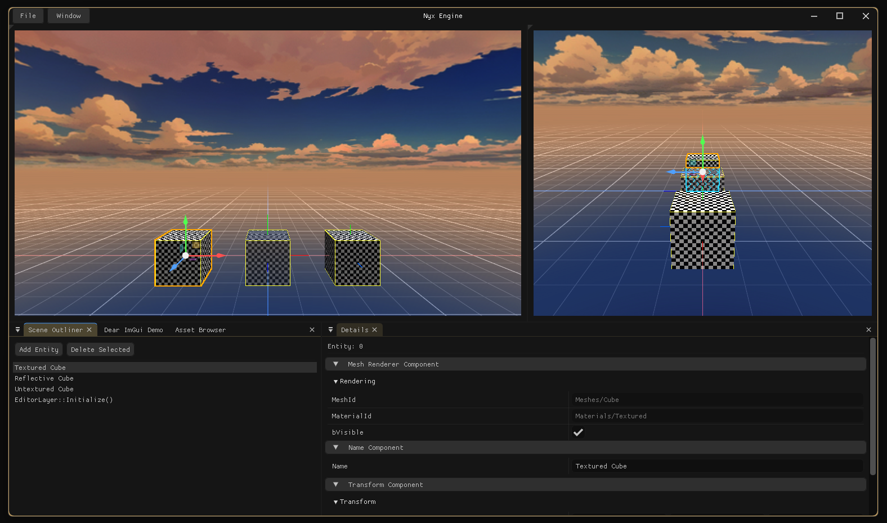

# Nyx

A hobby game engine and editor written in C++20, rendering with Vulkan.

Having worked on and with a variety of proprietary and off-the-shelf engines so far, I've started to feel the need to start implementing my own and from scratch - not just as an additional learning opportunity, but also to create my personal collection of 'best-of's of what I've worked with thus far. While being actively developed in my spare time, this project is still very much in its infancy at this point in time, with many of its key structures likely to change.



- [Docs/Architecture.md](Docs/Architecture.md): how the code is put together. Read it first.
- [Docs/Features.md](Docs/Features.md): what the editor and the game do.

## Requirements

- Windows 10 or 11
- Visual Studio 2022 with the *Desktop development with C++* workload
- CMake 3.23 or newer
- [Vulkan SDK](https://vulkan.lunarg.com/) (provides the Vulkan headers, Slang and `glslc`)

## Build and run

The dependencies are git submodules, so clone recursively:

```powershell
git clone --recursive https://github.com/LeonPapadopoulos/nyx.git
```

For an existing clone: `git submodule update --init --recursive`.

| Script | What it does |
| --- | --- |
| `Scripts\BuildEditor.bat` | Generates the project files and builds the editor (Debug) |
| `Scripts\BuildGame.bat` | Builds the game (Debug) and runs a scene: the file passed as argument, or `Assets\Scenes\Default.nyxscene` |
| `Scripts\GenerateProjectFiles.bat` | Generates the Visual Studio solution in `Build\Windows` |
| `Scripts\RebuildProjectFiles.bat` | Deletes `Build\Windows` and generates it again |
| `Scripts\BuildStartupPreview.bat` | Builds and opens the startup banner preview tool |
| `Scripts\FormatCode.bat` | Formats the code with clang-format (`check` only lists unformatted files) |

The editor ends up in `Build\Windows\Binaries\Debug\NyxEditor.exe`, the game next to it in `NyxGame.exe`. To work in Visual Studio, open the generated solution in `Build\Windows`; `NyxEditor` is the startup project. In the editor, **Play** runs the open scene in the game.

The tests run with `ctest -C Debug` in `Build\Windows`.

## Folder layout

```
Assets/          Scenes, models, materials, shaders, textures and startup artwork
Dependencies/    Git submodules: spdlog, GLFW, GLM, cgltf, SDL
Docs/            Architecture, features, and the images they use
Editor/          NyxEditor.exe: panels, gizmo, undo, asset browser, Play; themes in Editor/Themes
  Source/        One folder per concern: App, Scene, Properties, Transactions, Assets,
                 Materials, Play, Preferences, DevTools, Common
Engine/
  Shaders/       The engine's shaders, compiled by NyxShaderCompiler during the build
  Source/
    Runtime/     One folder per part: Core, Net, Input, Scene, Assets, UI (the painter and the
                 painted UI), Render (Vulkan), Link (editor link), Platform (window), App
    Reflection/  Reflection types and the NYX_REFLECT / NYX_PROPERTY macros
    DevTools/    The painter's test sheet, for the editor's Debug tools and the painter tests
    tests/       The engine's tests
Game/            NyxGame.exe: runs a scene, on its own or started by the editor
Scripts/         Build and formatting scripts
Startup/         The startup banner and its intro animations
ThirdParty/      Vendored libraries: Dear ImGui (docking branch), stb_image
Tools/
  NyxDump/           Prints scene files and link recordings as readable text
  NyxHeaderTool/     Reflection code generator and its tests
  NyxPadCheck/       Lists gamepads, prints what they report, tries rumble and trigger effects
  NyxShaderCompiler/ Compiles shaders with Slang, for the build and for live reload
```
